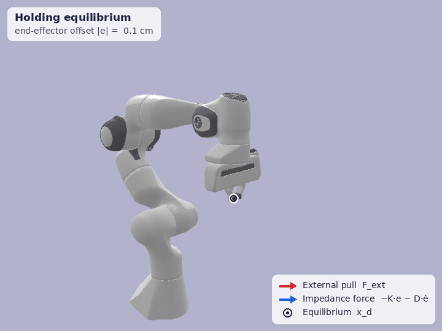

# Franka Panda Cartesian Impedance Control

This repository contains a Python implementation of a **Cartesian Impedance Controller** for the Franka Emika Panda robot using `pybullet`. Unlike standard position control, this approach allows the robot to interact compliantly with its environment, behaving like a tunable mass-spring-damper system.

<p align="center">
  
  <br>
  <em>Cartesian impedance control in PyBullet: a 20&nbsp;N external pull (red) displaces the end-effector by about F/K&nbsp;=&nbsp;20/150&nbsp;≈&nbsp;13&nbsp;cm, and the impedance force −K·e&nbsp;−&nbsp;D·ė (blue) pulls it back to the equilibrium x<sub>d</sub> once released.</em>
</p>

## ## Core Concepts

### 1. Cartesian Impedance Physics
The controller simulates a physical spring-damper connected to the robot's end-effector. The desired dynamic behavior is governed by:

$$F_{task} = -(K e + D \dot{e})$$


**Where:**
* **$K$ (Stiffness):** Defined as `stiffness_diag = [150, 150, 150, 10, 10, 10]`. It pulls the robot back to the equilibrium point.
* **$D$ (Damping):** Set to be **critically damped** ($D = 2\sqrt{K}$) to ensure the robot returns to position without oscillating or overshooting.

### 2. The Jacobian ($J$) & Torque Mapping
Since we want to control the robot in **Task Space** (Cartesian coordinates) but motors operate in **Joint Space** (Torques), we use the Jacobian matrix to bridge the two.


* **Velocity Mapping:** $\dot{x} = J(q)\dot{q}$
* **Force-Torque Duality:** $\tau_{task} = J(q)^T F_{task}$

By transposing the Jacobian, we translate the desired 3D force at the hand into the specific motor torques required across the 7-DOF arm.

### 3. Dynamics Compensation
To ensure the robot doesn't collapse under its own weight or struggle with high-speed inertial effects, the controller adds compensation terms:

* **Gravity ($\tau_g$):** Counteracts the weight of the robot links.
* **Coriolis ($\tau_C$):** Compensates for forces generated by the robot's own movement (centrifugal and Coriolis effects).

The final control law applied is:
$$\tau_{total} = \tau_{task} + \tau_g + \tau_C$$

---

## ## Engineering & Safety Features

* **1kHz Control Loop:** The simulation runs at $1000\text{Hz}$ ($dt=0.001$) to maintain numerical stability. High frequency is critical for haptic-like stability.
* **Torque Rate Limiting:** Torques are clipped to a maximum change of $1000\text{Nm/s}$, mimicking the hardware safety limits of the real Franka Emika Panda.
* **Orientation Error:** Uses a small-angle approximation via rotation matrices to compute the shortest path rotation error: $R_{\Delta} = R_{curr}^T R_d$.

---

## ## Getting Started

### Prerequisites
```bash
pip install pybullet numpy


### Run this for simulation
python franka_impedance_control.py
