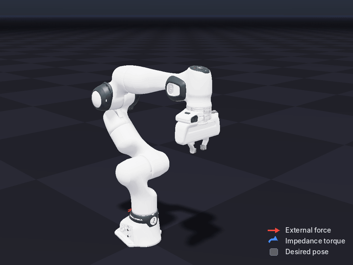

# Robotic Manipulation

Robot-manipulator control in simulation, starting with **Cartesian** and **joint impedance controllers** for the Franka arm. Unlike standard position control, these approaches allow the robot to interact compliantly with its environment, behaving like a tunable mass-spring-damper system.

Each controller is implemented in two physics engines:

| Engine | Folder | Runs on |
|---|---|---|
| [PyBullet](https://pybullet.org) | [`pybullet_sim/`](pybullet_sim) | CPU, one robot |
| [NVIDIA Newton](https://github.com/newton-physics/newton) | [`newton_sim/`](newton_sim) | GPU (CUDA) or CPU, many robots in parallel |

## Cartesian Impedance Control

<p align="center">
  
  <br>
  <em>Cartesian impedance control in PyBullet: the end-effector yields to an external force and springs back to equilibrium when released.</em>
</p>

### 1. Cartesian Impedance Physics
The controller simulates a physical spring-damper connected to the robot's end-effector. The desired dynamic behavior is governed by:

$$F_{task} = -(K e + D \dot{e})$$


**Where:**
* **$K$ (Stiffness):** Defined as `stiffness_diag = [150, 150, 150, 10, 10, 10]`. It pulls the robot back to the equilibrium point.
* **$D$ (Damping):** Set to be **critically damped** ($D = 2\sqrt{K}$) to ensure the robot returns to position without oscillating or overshooting.

### 2. The Jacobian ($J$) & Torque Mapping
Since we want to control the robot in **Task Space** (Cartesian coordinates) but motors operate in **Joint Space** (Torques), we use the Jacobian matrix to bridge the two.


* **Velocity Mapping:** $\dot{x} = J(q)\dot{q}$
* **Force-Torque Duality:** $\tau_{task} = J(q)^T F_{task}$

By transposing the Jacobian, we translate the desired 3D force at the hand into the specific motor torques required across the 7-DOF arm.

### 3. Dynamics Compensation
To ensure the robot doesn't collapse under its own weight or struggle with high-speed inertial effects, the controller adds compensation terms:

* **Gravity ($\tau_g$):** Counteracts the weight of the robot links.
* **Coriolis ($\tau_C$):** Compensates for forces generated by the robot's own movement (centrifugal and Coriolis effects).

The final control law applied is:
$$\tau_{total} = \tau_{task} + \tau_g + \tau_C$$

---

## Joint Impedance Control

<p align="center">
  
  <br>
  <em>Joint impedance control in PyBullet: each joint acts as a torsional spring-damper that pulls the arm back to its desired pose.</em>
</p>

Instead of a spring at the end-effector, the joint impedance controller ([PyBullet](pybullet_sim/joint_impedance.py), [Newton](newton_sim/joint_impedance.py)) places a torsional spring-damper on every joint, pulling the arm back to the desired configuration $q_d$:

$$\tau_{task} = K (q_d - q) - D \dot{q}$$

* **$K$ (Stiffness):** `stiffness_diag = [100, 100, 100, 100, 40, 30, 10]` Nm/rad, stiffer at the shoulder and softer towards the wrist.
* **$D$ (Damping):** $D = 2\sqrt{K}$, as in the Cartesian controller.

No Jacobian is needed, since the error is measured directly in joint space. Because all seven joints are held, the elbow cannot drift in the null space as it can under Cartesian control. Gravity and Coriolis compensation are the same as above.

```python
# pybullet_sim/joint_impedance.py: control law inside step()
tau_task = self.K @ (self.q_d - q) - self.D @ dq
tau_grav, tau_coriolis = self.get_dynamics(q_all, dq_all)
tau_d = tau_task + tau_coriolis + tau_grav
```

### In NVIDIA Newton

<p align="center">
  
  <br>
  <em>The same joint impedance controller in NVIDIA Newton (Franka FR3). The translucent arm is the desired pose the joints are pulled back to.</em>
</p>

---

## Engineering & Safety Features

* **1kHz Control Loop:** The simulation runs at $1000\text{Hz}$ ($dt=0.001$) to maintain numerical stability. High frequency is critical for haptic-like stability.
* **Torque Rate Limiting:** Torques are clipped to a maximum change of $1000\text{Nm/s}$, mimicking the hardware safety limits of the real Franka Emika Panda.
* **Orientation Error (Cartesian controller):** Uses a small-angle approximation via rotation matrices to compute the shortest path rotation error: $R_{\Delta} = R_{curr}^T R_d$.

---

## Getting Started

### PyBullet
```bash
pip install pybullet numpy
python pybullet_sim/cartesian_impedance.py   # Cartesian impedance control
python pybullet_sim/joint_impedance.py       # Joint impedance control
```

### NVIDIA Newton (GPU)
```bash
pip install "newton[examples]"
python newton_sim/cartesian_impedance.py                  # one robot in the interactive viewer
python newton_sim/joint_impedance.py --num-worlds 256     # 256 robots in parallel on the GPU
```
Right-click and drag on the robot to pull on it. Useful options: `--device cuda:0` or `cpu`, `--viewer null` to run headless, `--solver featherstone` to switch from the default MuJoCo Warp solver.

The Newton scripts run the same control laws, gains and neutral pose as Warp kernels, with one robot per simulated world, so the whole batch stays on the GPU. They use the Franka Research 3 (FR3) model from Newton's asset library, which is downloaded on first run. Without a GPU they still run on the CPU, but slower than real time. With `--solver featherstone`, the Cartesian controller's elbow can drift, since nothing damps its null-space motion.
